<!-- animated contribution graph: real data, boxes reveal cell by cell
     (regenerated daily by .github/workflows/update-profile-art.yml) -->

<h3><code>berkay@github ~ $ ./contributions.sh</code></h3>

 
 

<!-- ascii logo terminal (left) + neofetch info card (right). both svgs are
     840x884 so equal widths (420px) give equal heights. -->

<h3><code>berkay@github ~ $ whoami</code></h3>

<table>
<tr>
<td valign="top"></td>
<td valign="top"></td>
</tr>
</table>

 
 

<h3><code>berkay@github ~ $ ./contact.sh</code></h3>

<b>Crafting Modern Web, Mobile & AI Applications</b>

&nbsp;

 

